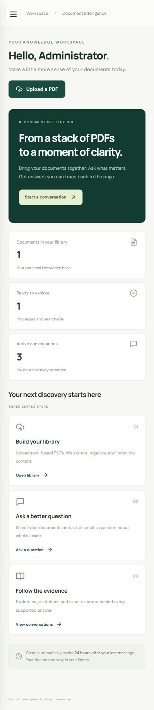
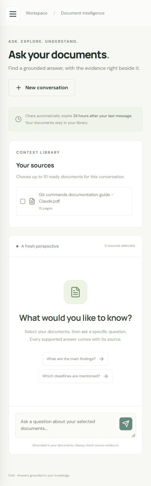

# Folio — AI-powered document Q&A

A complete local project with FastAPI, SQLAlchemy, Alembic, XAMPP MySQL/MariaDB, React/Vite/TypeScript, Bootstrap 5, Argon2id, JWT sessions, PyMuPDF, Chroma and configurable real AI providers. No sample documents or fake runtime answers are included.

## App screenshots

Real screenshots from the running responsive application. No chat messages, API keys, or PDF content are shown.

<table><tr><th>Dashboard</th><th>Document chat</th></tr><tr><td></td><td></td></tr></table>

## Settings window

After installing backend dependencies, double-click **Configure-Folio.cmd** in the project root. Alternatively:

```powershell
cd "D:\Web Works\document-qa\backend"
.\.venv\Scripts\python.exe configure_project.py
```

Enter your database URL, chat API endpoint/key and model, then click **Save settings**. Existing keys are masked and existing JWT secrets are preserved. The utility saves only to ignored `backend/.env`; restart the API and worker to apply changes. It does not install dependencies, create your database, run migrations, or launch services. Follow the setup instructions below for those steps. With a fresh checkout, follow the backend dependency installation step before opening the window.

For Groq, use `openai-compatible`, base URL `https://api.groq.com/openai/v1`, your own API key, and a model available in your account. Local embeddings still require the Ollama terminal. Changing embedding model settings requires reindexing documents.

Start with [Phase 1 architecture](docs/ARCHITECTURE.md), then follow the steps below. Source root: `D:\Web Works\document-qa`.

**On the current workstation:** dependencies, the private ignored `.env`, the dedicated database, migrations and default roles are prepared. An administrator account was created at your request; its credentials were provided in chat. The official portable CPU-only Ollama runtime and both configured models are installed, running and verified with a real cited-answer test. Start the local AI terminal from step 4 whenever you restart the project. See [initial validation](docs/VALIDATION.md) and [the AI fix and live verification](docs/AI-FIX-VALIDATION.md).

## 1. Windows prerequisites and XAMPP database

Install Python 3.12 or later, Node.js 22 or later, XAMPP and Ollama. This workstation uses Python 3.14 and Node 24; see the validation report for checks actually executed. Start **MySQL** in XAMPP Control Panel. Apache is only needed if you use phpMyAdmin; the Python app does not belong in `htdocs`.

Open XAMPP's MySQL shell:

```powershell
& 'C:\xampp\mysql\bin\mysql.exe' -u root -p
```

Enter your configured root password. A fresh development installation may have no root password; press Enter only if that is how your installation is configured. In the SQL shell, create a dedicated database and account. Replace the password locally; do not reuse the example text.

```sql
CREATE DATABASE document_qa CHARACTER SET utf8mb4 COLLATE utf8mb4_unicode_ci;
CREATE USER 'docqa'@'127.0.0.1' IDENTIFIED BY 'YOUR_LONG_RANDOM_DATABASE_PASSWORD';
GRANT SELECT, INSERT, UPDATE, DELETE, CREATE, ALTER, INDEX, DROP, REFERENCES
  ON document_qa.* TO 'docqa'@'127.0.0.1';
```

The migration account needs schema privileges. Production runtime credentials should use only SELECT/INSERT/UPDATE/DELETE after migrations are applied. XAMPP commonly ships MariaDB; all tables use InnoDB and portable SQLAlchemy types with UTF-8 and FK cascades.

## 2. Backend environment and dependencies

Run in PowerShell:

```powershell
Set-Location 'D:\Web Works\document-qa\backend'
python -m venv .venv
.\.venv\Scripts\python.exe -m pip install -r requirements.txt
Copy-Item .env.example .env
.\.venv\Scripts\python.exe -c "import secrets; print(secrets.token_urlsafe(48))"
notepad .env
```

Paste the generated secret into `JWT_SECRET`; set `DATABASE_URL` to the dedicated credentials. URL-encode special characters in the database password. Keep `.env` private; it is ignored by Git. The application refuses the example secret. `STORAGE_DIR=./data` is relative to the backend working directory; use an absolute private path for a service installation. All commands below assume the backend working directory unless stated otherwise.

`requirements.txt` provides compatible ranges; `requirements.lock.txt` records the exact environment used for local verification. Use the lock on the same Python/platform, or resolve from ranges on a different platform.

## 3. Migrations, roles and first administrator

```powershell
.\.venv\Scripts\python.exe -m alembic upgrade head
.\.venv\Scripts\python.exe -m app.cli init
.\.venv\Scripts\python.exe -m app.cli create-admin
```

Admin creation prompts for email/name/password; passwords never appear in command arguments or logs. Public registration always creates a regular user. Run initialization once after migration; it is idempotent. Do not call `Base.metadata.create_all()` in production.

## 4. Configure real embeddings and LLM

Default provider is local Ollama. On this workstation, an official portable CPU runtime is installed under `backend/data/ollama-runtime`. Start it in a separate PowerShell terminal and keep it open:

```powershell
Set-Location 'D:\Web Works\document-qa\backend'
.\.venv\Scripts\python.exe start_local_ai.py
```

Download the configured models once from another terminal:

```powershell
Set-Location 'D:\Web Works\document-qa\backend'
.\.venv\Scripts\python.exe download_ai_models.py
```

The helper uses the official vendor ZIP, downloads CPU components only, confines extraction to private project data, and validates ZIP lengths/CRCs. Models stay in `backend/data/models`; runtime and models are excluded from source archives and Git. Local cloud inference is disabled. This computer had only about 1.2 GB of free RAM, so the initial model is the compact `qwen2.5:0.5b`. It has lower reasoning capacity than larger models; backend quote validation still applies. For better answer selection, change `LLM_MODEL` to `qwen2.5:3b` or a larger model after freeing enough RAM, download that model, and restart the API/worker.

Alternatively, use a standard installed Ollama application and these commands:

```powershell
ollama pull nomic-embed-text
ollama pull qwen2.5:0.5b
```

Keep these backend settings:

```dotenv
AI_PROVIDER=ollama
AI_BASE_URL=http://127.0.0.1:11434
EMBEDDING_MODEL=nomic-embed-text
LLM_MODEL=qwen2.5:0.5b
```

Alternatively choose a real OpenAI-compatible endpoint implementing `/embeddings` and `/chat/completions` with JSON-mode support:

```dotenv
AI_PROVIDER=openai-compatible
AI_BASE_URL=https://YOUR_PROVIDER/v1
AI_API_KEY=YOUR_PRIVATE_API_KEY
EMBEDDING_MODEL=YOUR_EMBEDDING_MODEL
LLM_MODEL=YOUR_JSON_CAPABLE_CHAT_MODEL
```

The base URL includes `/v1` if required by the endpoint. Provider models must match their configured identifiers. Local mode does not require API keys. Provider calls time out after 120 seconds. Chat answers are selected, exact verified evidence quotes with filename/page/excerpt citations. Unsupported questions receive an explicit insufficient-information response. Read [provider privacy exceptions and grounding limitations](docs/SECURITY-AND-RETENTION.md) before enabling remote AI.

For a stronger hosted chat model while keeping existing local embeddings, get your own key from https://console.groq.com/keys and edit the ignored `backend/.env`:

```dotenv
AI_PROVIDER=ollama
AI_BASE_URL=http://127.0.0.1:11434
EMBEDDING_MODEL=nomic-embed-text
CHAT_PROVIDER=openai-compatible
CHAT_BASE_URL=https://api.groq.com/openai/v1
CHAT_API_KEY=YOUR_PRIVATE_GROQ_KEY
LLM_MODEL=qwen/qwen3.8-27b
```

Restart the API and worker after changing settings. Do not send keys in chat or put them in frontend code. This configuration sends the question and retrieved PDF excerpts to Groq; provider retention terms apply. It does not require reindexing because the embedding settings stay unchanged. Hosted mode was verified against Groq on 2026-10-10 using a private local key: both live PDF integration tests passed. The example configuration defaults to local AI; this workspace is configured for Groq chat. Check the provider models endpoint for identifiers available to your account. Official endpoint/model references: https://console.groq.com/docs/api-reference and https://console.groq.com/docs/model/llama-3.3-70b-versatile .

Short questions such as “my name” are expanded into a resume-name retrieval query. A matching page-one professional heading can be cited directly; the answer never takes a name from the filename or account profile. Other questions still use verified evidence selection. This targeted handling does not promise that every vague question will be answerable by the small local model.

## 5. Run API, worker and UI

Keep the AI-service terminal from step 4 running, then open three more PowerShell terminals.

**Terminal 1 — API**

```powershell
Set-Location 'D:\Web Works\document-qa\backend'
.\.venv\Scripts\python.exe -m uvicorn app.main:app --host 127.0.0.1 --port 8000 --no-access-log
```

**Terminal 2 — document processing and cleanup worker**

```powershell
Set-Location 'D:\Web Works\document-qa\backend'
.\.venv\Scripts\python.exe -m app.worker
```

Run one worker for this local storage configuration. Do not omit it: upload processing and regular physical cleanup depend on it. Queue leases and cleanup survive restarts; startup cleanup also runs on the API. Use supervision for unattended runs, as explained in the security document.

**Terminal 3 — frontend**

```powershell
Set-Location 'D:\Web Works\document-qa\frontend'
npm ci
npm run dev
```

Open [http://localhost:5173](http://localhost:5173). Use `localhost` consistently for UI/cookies; its development Origin is allowed in `.env.example`. The Vite proxy sends `/api` requests to FastAPI. API documentation is at [http://127.0.0.1:8000/api/docs](http://127.0.0.1:8000/api/docs).

Register or log in, upload a text-based PDF, wait for **Ready to explore**, choose it in chat and ask a specific question. Inspect citations and download the original through the authorized link. Failed jobs show a safe error and can be retried. Documents can be deleted independently of 24-hour chat expiry.

## 6. Retention behavior

Chats expire **24 hours after creation or the last successfully committed message, whichever is later**. Reads and unsuccessful requests do not extend retention. Expired chat APIs return 404 immediately. An independent cleanup thread deletes conversations, messages and excerpts every 60 seconds by default, plus startup sweeps. Document files, vectors and user accounts are unaffected by chat cleanup.

Manual or scheduled cleanup:

```powershell
Set-Location 'D:\Web Works\document-qa\backend'
.\.venv\Scripts\python.exe -m app.cli cleanup
```

See [the complete policy](docs/SECURITY-AND-RETENTION.md) for physical cleanup timing, unavailable services, backups/binlogs and external provider exceptions. No application backup is created. Exclude chat tables from backups if your stated policy forbids retaining chat content.

## 7. Tests and build

```powershell
Set-Location 'D:\Web Works\document-qa\backend'
.\.venv\Scripts\python.exe -m pytest -q
Set-Location 'D:\Web Works\document-qa\frontend'
npm test
npm run build
```

Backend tests use isolated SQLite with real SQLAlchemy FK cascades and real PyMuPDF-generated PDFs. Test doubles are confined to tests for deterministic AI/security cases. Runtime AI always calls a real provider. MySQL/Chroma/provider integration is separately described in [TESTING.md](docs/TESTING.md); passing unit tests does not imply those external services were verified.

## 8. Production checklist and troubleshooting

Serve `frontend/dist` and `/api` under one HTTPS origin through a reverse proxy; preserve backend `/api` paths. Add SPA fallback for frontend routes. Set `ENVIRONMENT=production`, `COOKIE_SECURE=true`, exact `CORS_ORIGINS`, private storage ACLs, supervised worker/API and restricted runtime DB credentials. Never expose XAMPP/phpMyAdmin or Chroma directly to the public internet. Configure a frontend CSP (self assets plus any font host used), TLS, request body limits and no request-body logging. Google Fonts is cosmetic and can be self-hosted or removed; system fonts are fallback.

- **Connection refused on 3306:** start XAMPP MySQL, check port and credentials.
- **Access denied:** match SQL host grant and encoded password in `DATABASE_URL`.
- **Uploads remain queued:** run the worker from the backend directory with the same `.env`.
- **Processing service unavailable:** start Ollama/check real model names; retry the PDF.
- **No extractable text:** OCR scanned PDFs outside the application before uploading.
- **Unsupported answers:** inspect source text and query specificity; calibrate `MAX_DISTANCE` on representative data rather than loosening it blindly.
- **CSRF or Origin errors:** use the Vite proxy and allowed localhost origin; cookies/header must match.
- **Session expired:** sign in again; token expiry defaults to 30 minutes.
- **Embedding model change:** increment `EMBEDDING_VERSION`, reindex documents and retire obsolete collections under a documented maintenance procedure. Do not silently mix vector dimensions.
- **Reindex existing ready PDFs after an embedding strategy update:** run `.\.venv\Scripts\python.exe -m app.cli reindex` and keep the worker running. It replaces each document's existing chunk IDs and preserves the original files. Changing model/version also requires retirement of old collections after successful reindexing.

Technical references: [FastAPI JWT security](https://fastapi.tiangolo.com/tutorial/security/oauth2-jwt/) and [Chroma Python client](https://docs.trychroma.com/reference/python).
