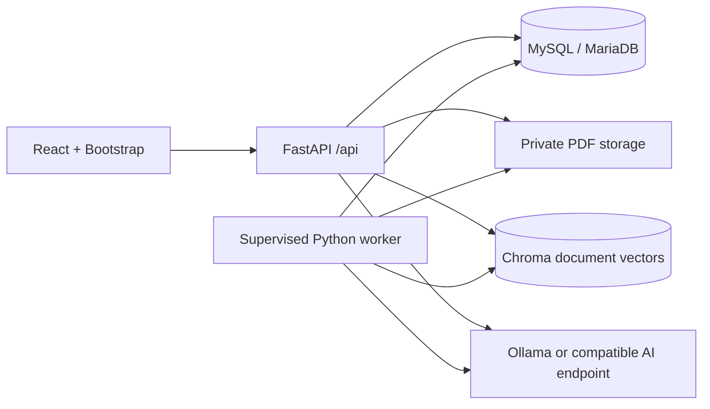

# Phase 1 — Architecture and schema

Folio is a local-first document Q&A application. React calls FastAPI through the Vite `/api` proxy during development. MySQL (XAMPP's MariaDB distribution is supported through PyMySQL) stores relational records. Original PDFs live outside the frontend in a private data directory. Chroma stores page-local document chunks and vectors. A separate Python worker polls a durable SQL queue and runs an independent retention sweep.



## Folder structure

```text
document-qa/
  README.md
  docs/
    ARCHITECTURE.md
    SECURITY-AND-RETENTION.md
    TESTING.md
  backend/
    .env.example
    requirements.txt
    requirements.lock.txt         # resolved dependency snapshot after installation
    alembic.ini
    alembic/env.py
    alembic/versions/             # versioned, frozen initial schema
    app/
      config.py                  # environment validation
      db.py                      # UTC sessions and engine
      models.py                  # SQL tables and relationships
      schemas.py                 # strict API input schemas
      security.py                # Argon2id, JWT sessions, CSRF, DB rate limiting
      routes.py                  # ownership, quotas, user and admin endpoints
      documents.py               # bounded extraction and page-local chunking
      ai.py                      # real embeddings, retrieval, evidence validation
      retention.py               # transactional cascade cleanup
      worker.py                  # durable document jobs + independent cleanup thread
      cli.py                     # role initialization and admin bootstrap
      main.py                    # API application and security middleware
    tests/
  frontend/
    package.json
    package-lock.json
    vite.config.ts
    src/
      api.ts                     # cookie/CSRF-aware HTTP client
      types.ts
      App.tsx                    # authentication, layout, overview
      pages.tsx                  # library, chat, history, profile, administration
      style.css
      App.test.tsx
```

## Relational schema

| Table | Purpose and relationships |
|---|---|
| users | Unique normalized email, Argon2id hash, active flag, role FK, JWT revocation version |
| roles / permissions / role_permissions | Immutable built-in roles, editable custom roles, server-side authorization |
| auth_sessions | JWT `jti` and expiry; logout deletes session; suspension/password changes revoke sessions |
| documents | Owner FK; original name, byte size, pages, status, attempts, worker lease |
| conversations | Owner FK, selected document IDs, UTC created/activity/expiry; expiry indexed |
| messages | Conversation FK with `ON DELETE CASCADE`; user/assistant content |
| sources | Message FK with cascade; document FK; exact excerpt, filename, page |
| usage_logs | User FK, event kind and units; composite index for daily question quotas; no chat content |
| audit_records | Actor/target IDs and fixed action names; no private content |
| app_limits | Global PDF size, document count and UTC daily question allowances |
| rate_buckets | Hashed rate limit keys and indexed window deadlines; persists across restarts |

Document selections use validated JSON IDs instead of a join table so a conversation can reference multiple owned documents without storing chat-dependent state in Chroma. Every selection is reauthorized through SQL before every answer. Deleting a document deletes conversations that reference it, immediately denies document reads, and queues durable filesystem/vector deletion. Foreign keys cascade message and source removal. User accounts are suspended rather than hard-deleted, preserving referential integrity and auditability.

## Processing and answer flow

1. Stream PDF to an internal UUID path with size, extension, MIME, signature and structural checks.
2. Commit a `queued` document. A worker leases it, extracts with PyMuPDF, checks page/text bounds, splits each page into 1,200-character chunks with 200-character overlap, embeds batches and upserts them into Chroma.
3. Status moves from queued → processing → ready or failed. Crashed jobs are reclaimed after lease expiry; explicit retry resets attempts. Embedding upserts use deterministic IDs and remove partial indexes first.
4. A question uses the same real embedding provider, owner/document metadata filtering and a cosine-distance threshold. SQL-authorized IDs are checked again after retrieval.
   Nomic corpus chunks use the required `search_document:` instruction and questions use `search_query:`. Ollama evidence output is constrained by a JSON schema with valid source indices; backend substring validation remains authoritative.
5. The configurable LLM selects exact excerpts. The backend validates indices and substring membership. It returns only verified quotes with citations, or an insufficient-information response. This deliberately favors evidence over unverified paraphrases. Relevance still depends on retrieval and model judgment; no system can guarantee every selected excerpt answers a question perfectly.
6. A successful message transaction stores the question, answer and references, increments usage and slides expiry to `last_activity_at + 24 hours`.

## Implementation phases

1. Architecture, schema and XAMPP commands: this document and README.
2. FastAPI/MySQL configuration: config.py, db.py, Alembic.
3. Authentication/authorization: security.py, strict schemas, auth/admin routes, bootstrap CLI.
4. PDF processing/indexing: documents.py, upload routes, durable worker.
5. RAG/citations: ai.py, conversation/message routes, citation UI.
6. Retention: retention.py, worker sweep, API expiry enforcement and tests.
7. Responsive UI: React/Vite/TypeScript/Bootstrap, real API integration.
8. Validation/setup: Pytest, React Testing Library, build, migration checks, security/retention documentation.

## Deployment shape

Use one local worker with one local Chroma directory and one API process for the Windows development configuration. Worker queue claims use SQL row locks; do not launch multiple workers sharing local Chroma until that deployment is explicitly tested. For distributed deployments, replace local Chroma with a protected Chroma server and add operational job coordination. Use HTTPS with a same-origin reverse proxy in production, disable development API docs and restrict database/filesystem accounts.
